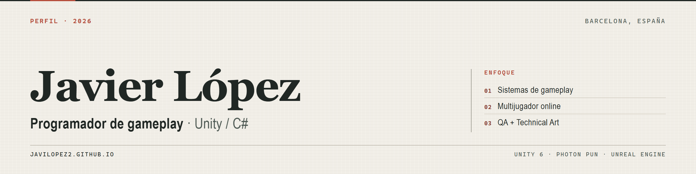

  

  <a href="https://javilopez2.github.io">Portfolio</a> ·
  <a href="https://javilopez2.itch.io">itch.io</a> ·
  <a href="mailto:javierlopez3482@gmail.com">Email</a>
   
  Barcelona, España · <a href="./README.md">Read in English</a>

## Programador de gameplay · Unity / C#

Construyo sistemas de juego en Unity con C#, con atención a que se puedan leer, probar y jugar. Mi recorrido en QA y Technical Art marca cómo trabajo: reproduzco un problema antes de tocar el código, documento lo que encuentro y sigo una funcionalidad hasta que se comporta bien en la build.

**Abierto a puestos de programación de gameplay.**

## Trabajo seleccionado

### Peñón del Sur · proyecto personal, en desarrollo

Juego de sigilo y hurto en Unity 6 sobre un mono ladrón en una ciudad turística. Sistemas en curso: sospecha y detección de NPC, hurto y minijuegos, inventario y mejoras, persecuciones y economía diaria. Todavía sin build pública.

### [Nada de Pensar](https://javilopez2.itch.io/ndp-nada-de-pensar-game) · proyecto personal, build WebGL pública

Party game online de cartas para hasta 7 jugadores: salas por código, flujo de turnos, mazos y puntuación sincronizados. La primera capa de red usaba Unity Netcode/Relay y fallaba en la build WebGL, así que la pasé a **Photon PUN** para conseguir una build jugable desde itch.io.

### [Fauna](https://fairygames.itch.io/fauna-fairygames) · proyecto colaborativo, Unreal Engine

Juego 3D de aventura, plataformas y puzles desarrollado con FairyGames. Figuro como coautor en la página de itch.io. En desarrollo.

### [Pompeii | The Last Tavern](https://javilopez2.itch.io/pompeii-the-last-tavern) · game jam de 3 días

Gestión de recursos en una sola pantalla: incendios, rocas, humo y un cliente que no se va. Hecho en tres días y publicado en itch.io, donde figuro como autor listado.

## Herramientas que uso

- **Unity** y **C#** para sistemas de gameplay, UI y funciones online.
- **Photon PUN** para salas, flujo de turnos y sincronización de estado.
- **Unreal Engine** en trabajo colaborativo; **C++** a nivel básico.
- **Git / GitHub**, **Jira** y **Perforce** en el día a día.
- **QA**: testing funcional, smoke y regresión; informes de error y pasos de reproducción.
- **Technical Art**: shaders y materiales, integración de assets y apoyo a pipelines.

## Experiencia

**QA Tester · Uplay Online** · sep 2022 – feb 2024

Testing manual funcional, smoke y regresión. Identificación, documentación y seguimiento de errores con programación y diseño, usando Jira, Git y Perforce en equipos Scrum/Kanban.

**Technical Artist en prácticas · Digital Legends** · feb 2025 – jul 2025

Pipelines de producción, shaders y materiales, optimización de recursos e integración técnica de assets, trabajando entre los equipos de arte y programación.

**Formación:** DAM, Desarrollo de Aplicaciones Multiplataforma · ENTI, Barcelona · finalizado en julio de 2025.

Español (nativo) · Catalán (C1) · Inglés (B2).

## Enlaces

[Portfolio](https://javilopez2.github.io) · [itch.io](https://javilopez2.itch.io) · [Email](mailto:javierlopez3482@gmail.com)

Última actualización: octubre de 2026
