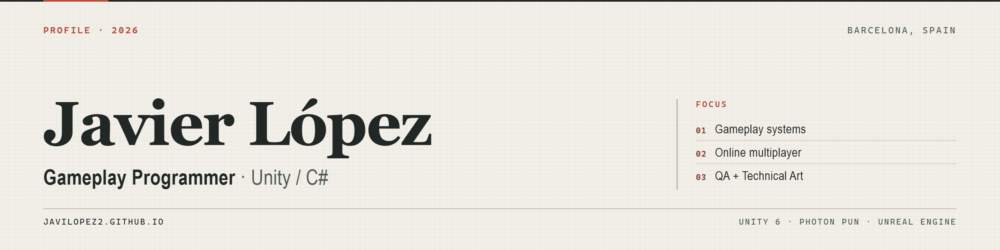

  

  <a href="https://javilopez2.github.io">Portfolio</a> ·
  <a href="https://javilopez2.itch.io">itch.io</a> ·
  <a href="mailto:javierlopez3482@gmail.com">Email</a>
   
  Barcelona, Spain · <a href="./README.es.md">Leer en español</a>

## Gameplay programmer · Unity / C#

I build game systems in Unity with C#, with an emphasis on making them readable, testable and playable. My background in QA and Technical Art shapes how I work: I reproduce a problem before changing code, I document what I find, and I follow a feature until it behaves in the build.

**Open to gameplay programming roles.**

## Selected work

### Peñón del Sur · personal project, in development

Stealth and theft game in Unity 6 about a thief monkey in a tourist town. Systems in progress: suspicion and NPC detection, theft and minigames, inventory and upgrades, chases and a daily economy. No public build yet.

### [Nada de Pensar](https://javilopez2.itch.io/ndp-nada-de-pensar-game) · personal project, public WebGL build

Online card party game for up to 7 players: rooms by code, turn flow, decks and score kept in sync. The first network layer used Unity Netcode/Relay and failed in the WebGL build, so I moved it to **Photon PUN** to get a build that runs from itch.io.

### [Fauna](https://fairygames.itch.io/fauna-fairygames) · collaborative project, Unreal Engine

3D adventure, platforming and puzzle game developed with FairyGames. I appear as co-author on the itch.io page. In development.

### [Pompeii | The Last Tavern](https://javilopez2.itch.io/pompeii-the-last-tavern) · 3-day game jam

Single-screen resource management: fires, rocks, smoke and one very persistent customer. Built in three days and released on itch.io, where I appear as the listed author.

## Tools I actually use

- **Unity** and **C#** for gameplay systems, UI and online features.
- **Photon PUN** for rooms, turn flow and state synchronisation.
- **Unreal Engine** in collaborative work; **C++** at a basic level.
- **Git / GitHub**, **Jira** and **Perforce** in day-to-day work.
- **QA**: functional, smoke and regression testing; bug reports and reproduction steps.
- **Technical Art**: shaders and materials, asset integration and pipeline support.

## Experience

**QA Tester · Uplay Online** · Sep 2022 – Feb 2024

Manual functional, smoke and regression testing. Identified, documented and followed up bugs with programmers and designers, using Jira, Git and Perforce in Scrum/Kanban teams.

**Technical Artist intern · Digital Legends** · Feb 2025 – Jul 2025

Production pipelines, shaders and materials, resource optimisation and technical asset integration, working between the art and programming teams.

**Education:** DAM, Multiplatform Application Development · ENTI, Barcelona · completed July 2025.

Spanish (native) · Catalan (C1) · English (B2).

## Links

[Portfolio](https://javilopez2.github.io) · [itch.io](https://javilopez2.itch.io) · [Email](mailto:javierlopez3482@gmail.com)

Last updated: October 2026
